# stochastic-risk

**Stochastic simulation for risk modeling and model validation: market, credit, counterparty and operational risk, with the statistics a validator needs.** Ten slide decks and the open code behind every number in them.

📊 **Overview deck:** [`slides/stochastic-risk-slides.pdf`](slides/stochastic-risk-slides.pdf) (50 pages) &nbsp;·&nbsp; 🔬 **Nine deep dives:** [`slides/decks/`](slides/decks/) &nbsp;·&nbsp; 📖 **Docs:** [`docs/`](docs/README.md) &nbsp;·&nbsp; ▶️ **Quick start:** [`examples/quickstart.py`](examples/quickstart.py)

Risk numbers are tail quantities of loss distributions that rarely have a closed form, so banks simulate them. Validating those numbers is a statistics problem with short samples and no known truth. This repository works the other way round: it simulates from models whose truth is known, then measures how well the standard estimators, tests and approximations recover it. The overview deck covers the regulatory setting (Basel FRTB, IRB, IMM, and the 2026 US guidance SR 26-2), the core models, what the simulations show, and open problems. Each deep dive takes one topic further: the model and its math, the statistics, figures from this code, published rules and research, and takeaways for a risk or validation team.

There is no market or bank data here. Every figure is a simulation with fixed seeds, every closed form is checked against an independent computation, and the slides read every number from files the code writes. Facts about regulation are quoted from the cited documents.

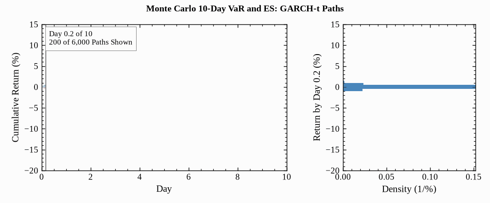

*Monte Carlo 10-day VaR and ES under a GARCH-t model. First, 200 return paths grow day by day while the distribution of all 6,000 simulated paths widens (right). Then the estimate uses more and more paths: the histogram of 10-day returns converges to a 200,000-path reference, and the 99% VaR and 97.5% ES settle.*

## The deep dives

| # | Deck | Math | Statistics | New in this repository |
|---|---|---|---|---|
| 1 | [VaR and ES](slides/decks/01-var-es-market-risk.pdf) | coherence, elicitability, FRTB liquidity horizons, GARCH, EVT | five estimators against a known truth | FRTB cascade is exact for independent Gaussian classes; filtered estimators cut ES error by about a factor of three |
| 2 | [Backtesting](slides/decks/02-backtesting-var-es.pdf) | traffic light, Kupiec, Christoffersen, Acerbi-Székely $Z_2$, P&L attribution (PLA) | test size and power by simulation | $\chi^2$ size errors at 250 days; ES test power 49% against 33%; PLA zones under three error types |
| 3 | [Model risk](slides/decks/03-model-risk-estimation-risk.pdf) | SR 26-2, predictive distributions, relative-entropy worst case | exact exceedance laws, bootstrap coverage | exceedance of estimated VaR in closed form; worst case exact for normal losses, undefined for heavy tails; challenger spread |
| 4 | [Credit portfolio](slides/decks/04-credit-portfolio-risk.pdf) | one-factor model, IRB formula, copulas | exact binomial mixture | second-order granularity correction in factor space; a $t$ copula with 4 degrees of freedom gives 2.7 times the Gaussian 99.9% loss; importance sampling |
| 5 | [PD validation](slides/decks/05-pd-model-validation.pdf) | AUC, DeLong, binomial, Jeffreys, PSI | size and power under correlated defaults | independent-default tests reject a correct PD 20% of the time at asset correlation 0.12; PSI false alarms in small samples |
| 6 | [Counterparty risk](slides/decks/06-counterparty-risk-cva.pdf) | Hull-White, EE, PFE, EEPE, CVA | Monte Carlo against Jamshidian | exact exposure check at reset dates; wrong-way CVA 2.4 times the independent value |
| 7 | [Monte Carlo](slides/decks/07-monte-carlo-methods.pdf) | nested simulation, importance sampling, Sobol points | RMSE against budget | inner-sample bias and the optimal split; QMC error slope −0.76 against −0.51 |
| 8 | [Operational risk](slides/decks/08-operational-risk-evt.pdf) | compound Poisson, FFT, Panjer, single-loss approximation, POT, Hill | capital estimation uncertainty | SLA error by level and tail; 99.9% capital from 100 losses ranges 0.37 to 2.52 times its true-parameter value |
| 9 | [Stress testing](slides/decks/09-stress-testing.pdf) | reverse stress, regimes, FRTB stress calibration, generative scenarios | conditional Monte Carlo | FRTB indirect calibration biased low when correlations rise; the 75% rule mostly fixes it here |

Each deck has a matching page in [`docs/topics/`](docs/topics/).

## See the simulations

Every risk number in this repository is a statistic of a simulated random object. These figures show the objects themselves. The animations come from [`experiments/animations.py`](experiments/animations.py) and the gallery from [`experiments/gallery.py`](experiments/gallery.py), with the models and parameters of the matching experiments.

| | |
|:---:|:---:|
| 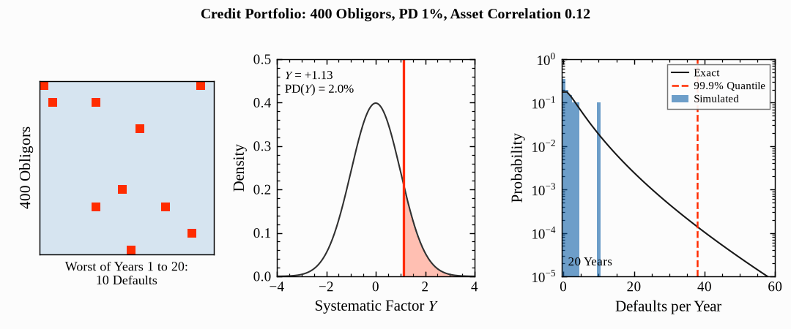 | 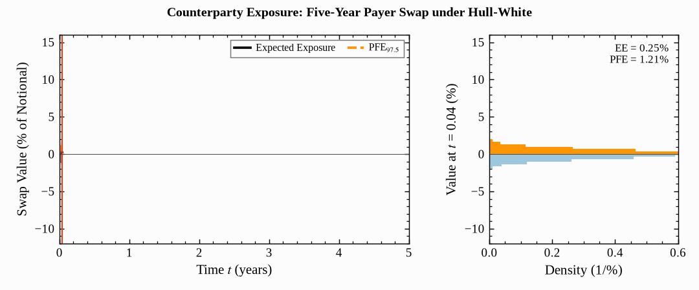 |
| *A loan book of 400 obligors (PD 1%, asset correlation 0.12), 20 simulated years per frame: the worst year of each 100-year block, the systematic factor behind it, and the default-count histogram converging to the exact binomial mixture.* | *Hull-White paths of a five-year payer swap: expected exposure and the 97.5% PFE build up week by week, and the value distribution (right) shows the exposure part in orange.* |
| 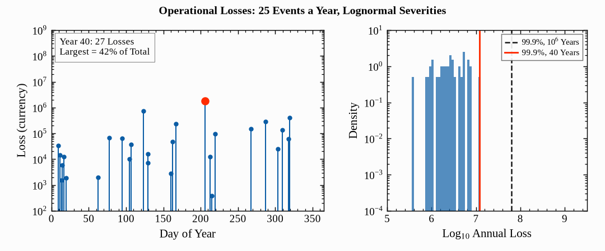 | 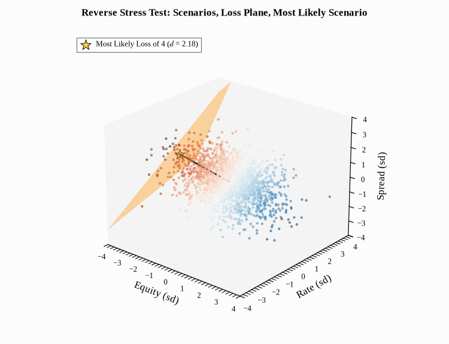 |
| *Operational losses, 40 simulated years per frame (25 events a year, lognormal sizes): one year's losses on the left, while the annual-loss histogram and its 99.9% quantile estimate fill in over 8,000 years.* | *Reverse stress test in 3D: scenarios coloured by portfolio loss, the plane of scenarios that lose 4 units, and the most likely of them.* |

One gallery figure per topic, mixing 3D views with 2D path and sampling-distribution plots:

| | |
|:---:|:---:|
| 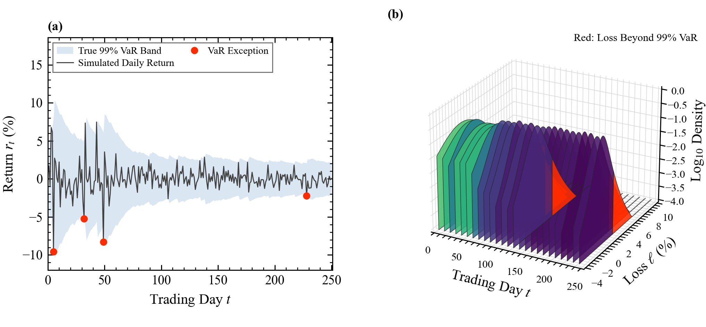 | 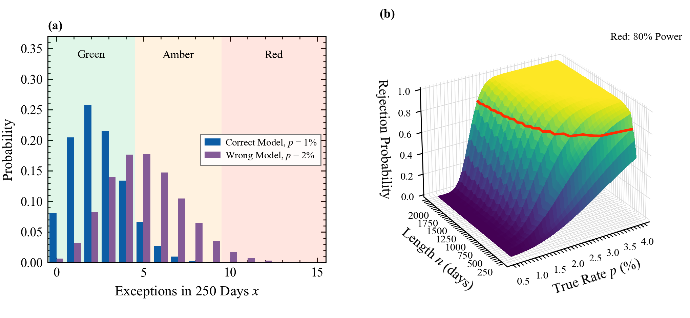 |
| *1. A simulated GARCH-t year inside its true 99% VaR band, and the conditional loss density every tenth day (red: beyond VaR).* | *2. Exception counts over the Basel zones, and the power surface of the exact count test against the true rate and the backtest length.* |
| 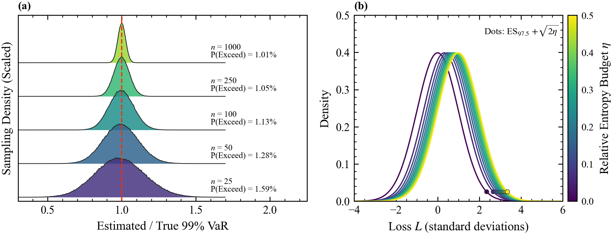 | 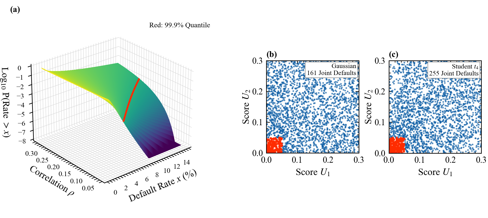 |
| *3. Sampling distributions of an estimated VaR for five window lengths, and worst-case exponential tilts.* | *4. The Vasicek tail-probability surface with its 99.9% quantile, and joint defaults under Gaussian and Student t copulas.* |
| 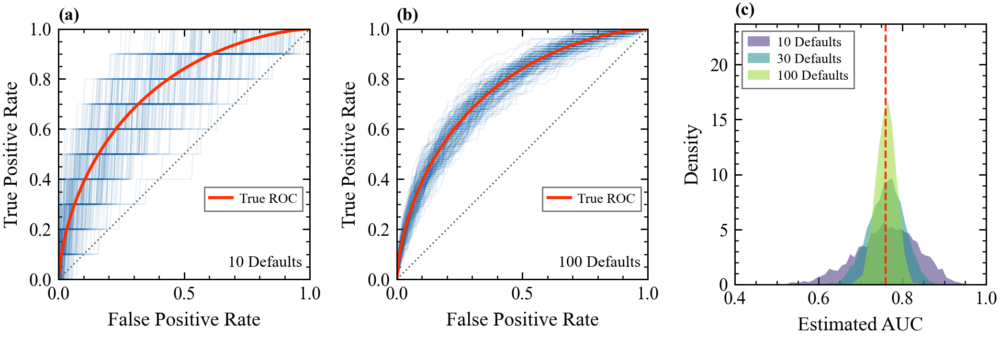 | 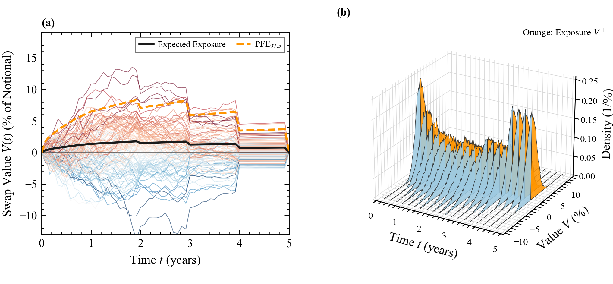 |
| *5. Simulated ROC curves around the true curve, and the sampling density of the AUC for 10, 30 and 100 defaults.* | *6. Hull-White swap value paths, and the value distribution every quarter with the exposure part in orange.* |
| 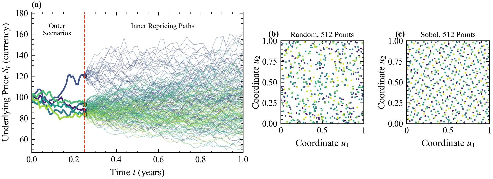 | 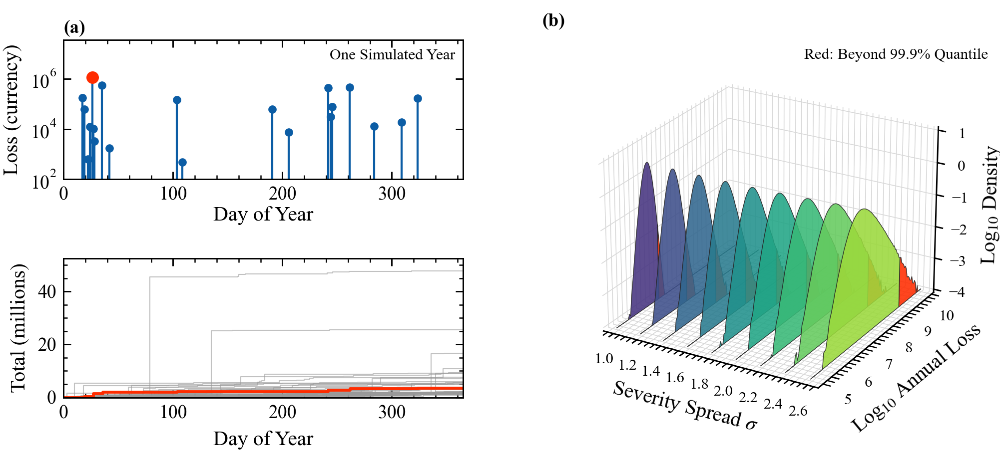 |
| *7. A nested simulation tree, and random against scrambled Sobol points.* | *8. One simulated year of operational losses, and annual-loss distributions against the severity spread (red: beyond the 99.9% quantile).* |
| 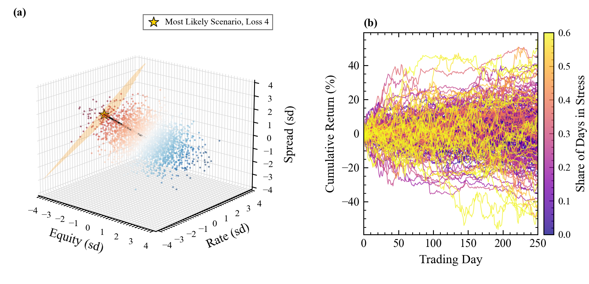 | |
| *9. A 3D cloud of stress scenarios with the loss plane, and regime-switching paths coloured by time spent in stress.* | |

## Results that are new in this repository

Small, checkable results from the code here. They are statements about the stated models, not about any bank or market.

- **Estimated VaR is exceeded more often than its level says.** For $n$ i.i.d. normal losses and the plug-in VaR $\bar L + s z_\alpha$ (sample mean $\bar L$, sample standard deviation $s$, normal quantile $z_\alpha$), the exceedance probability is exactly $1 - T_{n-1}\big(z_\alpha/\sqrt{1+1/n}\big)$, with $T_{n-1}$ the Student $t$ distribution function: 1.59% at $n = 25$ and 1.05% at $n = 250$ for a 99% VaR. Historical simulation with the $k$-th smallest of $n$ losses is exceeded with probability $(n+1-k)/(n+1)$ for any continuous distribution.
- **Backtests have the wrong size at Basel sample lengths.** At 250 days the Christoffersen independence test rejects a correct model 1.2% of the time instead of 5%; it is still 2.3% at 10,000 days. Clustered exceptions with the right rate show up in the Kupiec count test (38.6%) more than in the independence test (3.1%).
- **Bootstrap intervals for ES under-cover.** Percentile intervals for the 97.5% ES from 250 days cover the truth 82% (normal) and 75% (Student $t_3$) of the time, not 95%.
- **Relative-entropy worst case.** For normal losses the worst-case ES over all models within relative entropy $\eta$ of the nominal one is ES $+\sqrt{2\eta}$ standard deviations; simulation matches to 0.004. For Student $t_4$ losses the worst case does not exist, and sample answers drift with the number of scenarios.
- **Granularity in factor space.** A second-order expansion of the loss quantile, done in the systematic factor, gives a correction that matches the exact binomial mixture: with 89 names (PD 1%, $\rho = 0.12$), exact 11.2%, corrected 11.3%, infinitely granular 9.03%.
- **Correlated defaults break PD calibration tests.** With asset correlation $\rho = 0.12$, binomial and Jeffreys tests reject a correct 1% PD 20% of the time at the 5% level. A correlation-adjusted test has size 5.0% but only 19% power against a doubled PD.
- **Wrong-way risk.** With a hazard rate tied to exposure and calibrated to the same credit curve, payer-swap CVA is 2.40 times the independent value when the log hazard rises by $b = 0.3$ per 1% of notional exposure, and 0.26 times at $b = -0.3$.
- **FRTB stress calibration.** When correlations rise in stress, a one-factor reduced set gives 0.66 of the true stressed ES; the first reduced set meeting the 75% rule gives 0.98.

## Verification

| Result | Check | Agreement |
|---|---|---|
| Empirical VaR and ES | normal and $t$ closed forms | 1% to 2% |
| FRTB liquidity-horizon cascade | independent Gaussian classes | exact |
| Plug-in VaR exceedance (Student $t$ law) | Monte Carlo | within 4 s.e. |
| Historical simulation exceedance | normal and $t_3$ losses | within 0.15 percentage points |
| Relative-entropy worst-case ES | Gaussian closed form | 0.004 |
| $Z_2$ critical values | published −0.7 and −1.8 | −0.74 and −2.00 |
| IRB capital | reference value | $10^{-5}$ |
| Granularity correction | exact binomial mixture | closer than the infinitely granular value |
| Importance sampling, credit losses | exact binomial mixture | within 4 s.e. |
| Hull-White bonds and swaptions | martingale test; Jamshidian | $2 \times 10^{-4}$; within 0.7 s.e. |
| Nested simulation | exact Black-Scholes loss | converges |
| FFT compound Poisson | Panjer recursion; Monte Carlo | $10^{-10}$; 2% |
| Reverse stress scenario | conditional Monte Carlo mean | 0.016 |

s.e.: standard error. The exact numbers regenerate in [`results/`](results/) on every run, and the slides read them from there.

## Quick start

```bash
git clone https://github.com/syaohui/stochastic_risk_modeling.git
```

```bash
pip install -e ".[test]"
```

```python
from stochastic_risk import backtest, credit, model_risk, pd_validation

# Basel traffic light: probability that a correct 99% VaR lands green, amber, red in 250 days
print(backtest.zone_probabilities(0.01))                       # 0.892, 0.108, 0.00025

# Exact exceedance probability of a plug-in normal 99% VaR fitted to 250 days
print(model_risk.plugin_normal_exceedance(250, 0.99))          # 0.01053

# Basel IRB capital per unit EAD: PD 1%, LGD 45%, maturity 2.5 years
print(credit.irb_capital(0.01, lgd=0.45, m=2.5))               # 0.07385

# 15 defaults among 1,000 obligors with PD 1%: independent and correlation-adjusted p-values
print(pd_validation.binomial_pvalue(15, 1000, 0.01))           # 0.0824
print(pd_validation.vasicek_pvalue(15, 1000, 0.01, 0.12))      # 0.2182
```

More calls, one per module: `python examples/quickstart.py`.

## Reproduce everything

```bash
python -m pytest tests
```

```bash
cd experiments
python run_all.py --compute --jobs 8
python run_all.py --plot
cd ..
```

```bash
python build_slides.py
```

```bash
python experiments/animations.py
```

24 tests (about 20 seconds). 19 experiments with fixed seeds. Each has a compute step that saves raw arrays to `results/raw/` and a plot step that writes the figure to `figures/` and the numbers to `results/`. The compute step is about half an hour of CPU time; on one 16-core cluster node it took eight minutes. The raw arrays are in the repository, so `python run_all.py --plot` alone rebuilds every figure and number in about fifteen seconds. The gallery's simulation takes seconds and runs with the experiments; the five animations take a few minutes of CPU time to render. `build_slides.py` compiles the overview and the nine deep dives; it needs LaTeX with `latexmk` and the Metropolis Beamer theme. Details: [docs/reproducibility.md](docs/reproducibility.md).

## Repository layout

```
stochastic-risk/
├── slides/
│   ├── stochastic-risk-slides.pdf   overview deck (50 pages)
│   ├── decks/                       the nine deep-dive PDFs
│   ├── main.tex, parts/             overview deck source
│   ├── topics/                      deep-dive sources t1 to t9
│   ├── preamble.tex                 shared style; reads results/*.tex
│   └── refs.bib                     verified references
├── src/stochastic_risk/             one module per topic (NumPy, SciPy)
│   ├── measures.py                  VaR, ES, closed forms, FRTB liquidity horizons
│   ├── volatility.py                GARCH(1,1) simulation and fitting, EWMA
│   ├── evt.py                       peaks over threshold, Hill estimator
│   ├── backtest.py                  traffic light, Kupiec, Christoffersen, Z2, PLA
│   ├── model_risk.py                estimation risk, bootstrap, worst-case tilt
│   ├── credit.py                    one-factor model, IRB, granularity, copulas, IS
│   ├── pd_validation.py             AUC, DeLong, binomial, Jeffreys, adjusted test, PSI
│   ├── ccr.py                       Hull-White, swap exposure, swaptions, CVA, WWR
│   ├── montecarlo.py                nested simulation, importance sampling, Sobol
│   ├── oprisk.py                    compound Poisson by FFT and Panjer, SLA
│   └── stress.py                    reverse stress, regimes, FRTB stress calibration
├── experiments/                     e01 to e19, gallery.py, animations.py, run_all.py
├── tests/                           24 checks against independent results
├── examples/quickstart.py           one call per module, with printed values
├── docs/                            topic pages, API, reproducibility, reading list
├── figures/                         generated figures (PNG); gallery/ and animations/ (GIF)
├── results/                         generated numbers (JSON, LaTeX macros) and raw arrays
└── build_slides.py                  compiles all decks
```

## Conventions

Losses are positive when money is lost. Returns are fractions of value, and daily unless a page says otherwise. Probabilities and rates are decimals in code and percentages on slides. Every symbol is defined where it first appears. Where a code name differs from the slide symbol, the module docstring gives the mapping.

## Contributing, citing, licence

- Contributions: see [CONTRIBUTING.md](CONTRIBUTING.md). A new model needs a module, an independent test, and an experiment that writes its figure and numbers.
- Citing: use [`CITATION.cff`](CITATION.cff); GitHub shows a "Cite this repository" button.
- Licence: MIT, see [`LICENSE`](LICENSE).

Research and teaching code. It is not a production risk system, the parameters are illustrative, and nothing here is regulatory or investment advice.
