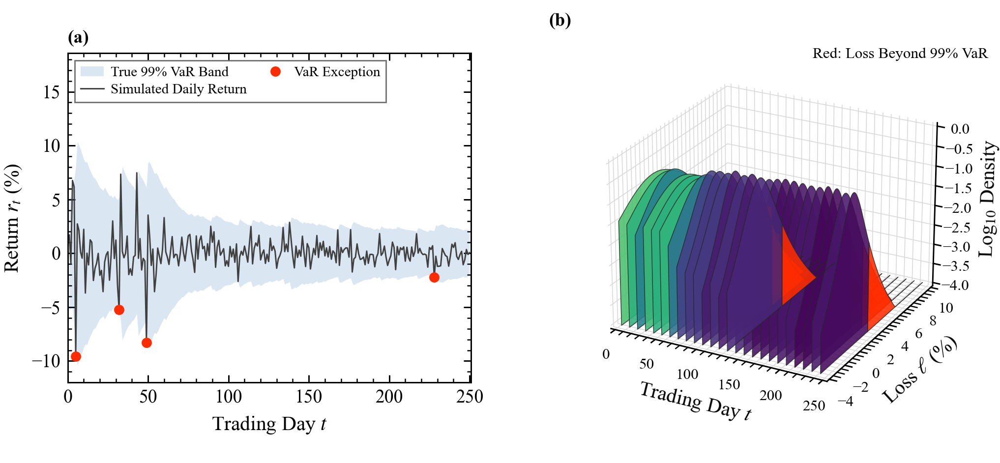
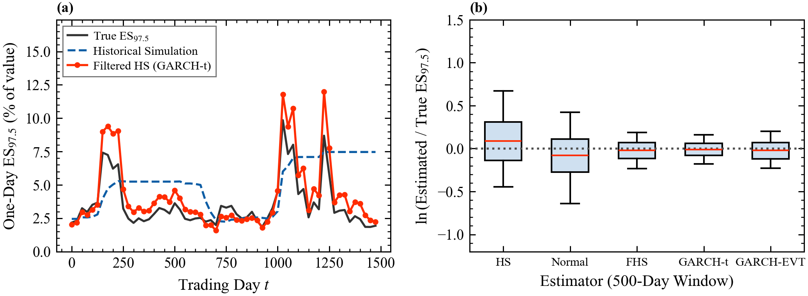

# 1. Market risk: VaR and expected shortfall

Deck: [`slides/decks/01-var-es-market-risk.pdf`](../../slides/decks/01-var-es-market-risk.pdf) · Code: [`measures.py`](../../src/stochastic_risk/measures.py), [`volatility.py`](../../src/stochastic_risk/volatility.py), [`evt.py`](../../src/stochastic_risk/evt.py) · Experiments: `e01_estimators.py`, `e02_scaling.py`

*A simulated GARCH-t year inside its true 99% VaR band, and the true one-day loss density every tenth day on a log scale (red: losses beyond that day's VaR).* Animated: [`a1_monte_carlo_var.gif`](../../figures/animations/a1_monte_carlo_var.gif).

## The question

A trading book's loss over the next day or ten days is random. One number must summarize its tail, be estimated from a few hundred days of data, and hold up in front of a regulator. Which number, which estimator, and how to move from one day to ten days and to longer liquidity horizons?

## Definitions

Let $L$ be the loss over the horizon (currency; positive is a loss) and $\alpha \in (0,1)$ the confidence level. Then

$$\mathrm{VaR}_\alpha(L) = \inf\{x : P(L \le x) \ge \alpha\}, \qquad \mathrm{ES}_\alpha(L) = \frac{1}{1-\alpha}\int_\alpha^1 \mathrm{VaR}_u(L)\,\mathrm{d}u.$$

For a continuous loss, $\mathrm{ES}_\alpha = E[L \mid L \ge \mathrm{VaR}_\alpha]$, the average loss on the worst $1-\alpha$ of days.

- **Coherence.** ES is coherent (Acerbi and Tasche, 2002). VaR is not sub-additive, so merging two books can raise it (Artzner et al., 1999).
- **Elicitability.** VaR minimizes an expected scoring function (the quantile loss), so VaR forecasts can be ranked by a score. ES alone is not elicitable (Gneiting, 2011), but the pair (VaR, ES) is (Fissler and Ziegel, 2016). ES backtests therefore use the VaR forecast too (topic 2).
- **Closed forms.** With $z = \Phi^{-1}(\alpha)$, $\varphi$ the normal density, mean $\mu$ and standard deviation $\sigma$: $\mathrm{ES}_\alpha = \mu + \sigma\varphi(z)/(1-\alpha)$. For a Student $t_\nu$ loss with $\nu$ degrees of freedom, density $g_\nu$ and $q = t_\nu^{-1}(\alpha)$: $\mathrm{ES}_\alpha = \frac{g_\nu(q)}{1-\alpha}\frac{\nu + q^2}{\nu - 1}$.

## FRTB internal models (Basel MAR33)

- ES at 97.5%, base horizon $T = 10$ days, liquidity horizons $LH_j$ = 10, 20, 40, 60, 120 days.
- Liquidity-adjusted ES: with $\mathrm{ES}_T(P)$ the 10-day ES of portfolio $P$ under shocks to all risk factors, and $\mathrm{ES}_T(P, j)$ the 10-day ES under shocks to the risk factors whose horizon is at least $LH_j$,
  $$\mathrm{ES}^2 = \mathrm{ES}_T(P)^2 + \sum_{j \ge 2}\mathrm{ES}_T(P,j)^2\,\frac{LH_j - LH_{j-1}}{T}.$$
- Calibrated to a 12-month stress period through a reduced set of risk factors that explains at least 75% of the full ES (topic 9).
- Multiplier $m_c = 1.5$ plus a backtesting add-on of 0 to 0.5. In the EU these rules apply from 1 January 2027.

**Derived here.** For independent risk-factor classes with Gaussian P&L that scales like $\sqrt{t}$, the cascade equals the ES of each class scaled to its own horizon. `test_lh_cascade_exact_for_independent_gaussian` checks it. With correlated classes the cascade is a convention, not a theorem.

## Five estimators

Returns $r_t$ (fraction of value), losses $L = -r$, window of $n = 500$ days.

| Estimator | What it does |
|---|---|
| Historical simulation (HS) | empirical VaR and ES of the window |
| Normal | mean and standard deviation of the window |
| GARCH-t | GARCH(1,1) $\sigma_t^2 = \omega + a r_{t-1}^2 + b\sigma_{t-1}^2$ with Student $t$ innovations, fitted by maximum likelihood; forecast volatility $\hat\sigma_{t+1}$ times the fitted $t$ quantiles |
| Filtered HS (FHS) | $\hat\sigma_{t+1}$ times empirical quantiles of the standardized losses $-r_s/\hat\sigma_s$ |
| GARCH-EVT | a generalized Pareto tail (shape $\xi$, scale $\beta$) above a threshold $u$ on standardized losses (McNeil and Frey, 2000) |

Here $\omega$ is the variance intercept (per day), $a, b \ge 0$ with $a + b < 1$.

## Results in this repository

- **Estimators against a known truth (E01).** Truth: GARCH-t with $a = 0.08$, $b = 0.90$, $\nu = 5$, unconditional volatility 1.2% a day; 1,000 independent windows. RMSE of $\ln(\widehat{\mathrm{ES}}/\mathrm{ES})$: HS 0.37, normal 0.34, FHS 0.13, GARCH-t 0.10, GARCH-EVT 0.14. HS falls below two thirds of the true ES in 6% of windows; FHS never does.
- **Square-root-of-time scaling (E02).** $\mathrm{ES}_{10} = \sqrt{10}\,\mathrm{ES}_1$ is exact only for i.i.d. Gaussian returns. Monte Carlo 10-day ES over the scaled value: 1.06 at half the average GARCH volatility, 0.92 at 2.5 times, and 0.89 for i.i.d. $t_5$ returns.

## Takeaways

- Prefer ES for capital, but keep VaR: backtests need it.
- Filter volatility before using history; HS reacts slowly to a change in volatility.
- Treat any horizon scaling as a model with its own error.

**Assumptions.** One asset; GARCH(1,1) is the true model, so conditional estimators are favored. Real data add misspecification (topic 3).

## Open questions

ES for portfolios with many non-linear positions at 97.5% over stressed periods, with honest error bars; the right correlation treatment in the liquidity-horizon cascade.
