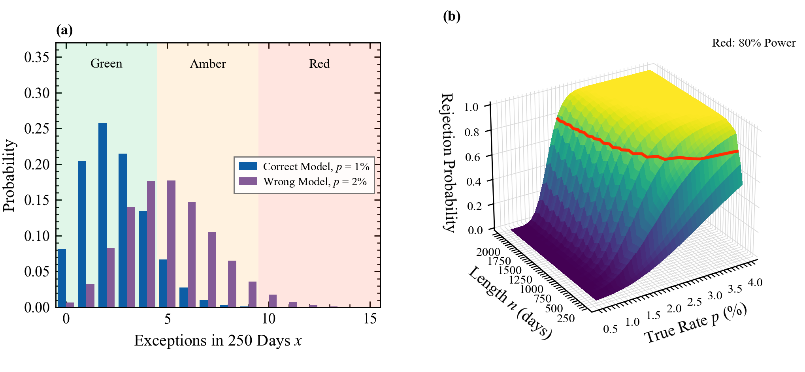
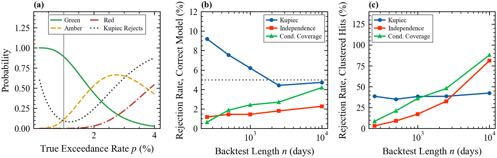

# 2. Backtesting VaR and expected shortfall

Deck: [`slides/decks/02-backtesting-var-es.pdf`](../../slides/decks/02-backtesting-var-es.pdf) · Code: [`backtest.py`](../../src/stochastic_risk/backtest.py) · Experiments: `e03_var_backtests.py`, `e04_es_backtest.py`, `e05_pla.py`

*Exception counts in 250 days for a correct 99% VaR and for a model with twice the exception rate, over the Basel zones; and the rejection probability of the exact count test against the true rate and the backtest length (red: 80% power).*

## The question

A risk model forecasts a tail every day. A year later there are 250 outcomes. Can we tell a good model from a bad one, and how often do we get it wrong? Regulators turn backtest outcomes into capital, and validation teams need tests with known size (false alarms) and known power (missed problems). Simulation gives both, because the truth is known.

## Exception tests

The hit $I_t = \mathbf{1}\{L_t > \mathrm{VaR}_t\}$ marks an exception on day $t$. Under a correct VaR at level $\alpha$, the $I_t$ are i.i.d. Bernoulli($p$) with tail probability $p = 1 - \alpha$. With $x$ exceptions in $n$ days and $\hat p = x/n$:

- **Proportion of failures** (Kupiec, 1995): $LR_{pof} = -2\ln\frac{(1-p)^{n-x}p^x}{(1-\hat p)^{n-x}\hat p^{\,x}} \sim \chi^2_1$.
- **Independence** (Christoffersen, 1998): a two-state Markov chain with $\pi_{ij} = P(I_t = j \mid I_{t-1} = i)$, tested against $\pi_{01} = \pi_{11}$; $LR_{ind} \sim \chi^2_1$. Conditional coverage $LR_{cc} = LR_{pof} + LR_{ind} \sim \chi^2_2$.

The $\chi^2$ laws hold only as $n \to \infty$.

## Basel traffic light (MAR32)

99% VaR over 250 days. Exceptions count the larger of the actual-P&L and hypothetical-P&L exceptions.

| Zone | Exceptions | Multiplier |
|---|---|---|
| Green | 0 to 4 | 1.50 |
| Amber | 5, 6, 7, 8, 9 | 1.70, 1.76, 1.83, 1.88, 1.92 |
| Red | 10 or more | 2.00 |

A desk with more than 12 exceptions at 99% or more than 30 at 97.5% in a year moves to the standardised approach (MAR32.19).

## ES backtest

Acerbi and Székely (2014), test 2. With returns $X_t$ (gains positive), forecasts $\mathrm{VaR}_t$ and $\mathrm{ES}_t$ at tail probability $p$, $I_t = \mathbf{1}\{X_t + \mathrm{VaR}_t < 0\}$ and $T$ days:

$$Z_2 = \sum_{t=1}^{T}\frac{X_t I_t}{T\,p\,\mathrm{ES}_t} + 1, \qquad E_{H_0}[Z_2] = 0.$$

$Z_2$ is negative when risk is underestimated. The authors report critical values of about −0.7 at 5% and −1.8 at 0.01% for $T = 250$, stable across Student $t$ models. Regression-based ES backtests are an alternative (Bayer and Dimitriadis, 2022).

## FRTB P&L attribution (PLA)

Each desk compares, over 250 days, the hypothetical P&L (HPL) from front-office pricing with the risk-theoretical P&L (RTPL) from the risk model (MAR32.20 to MAR32.42). Green if the Spearman rank correlation exceeds 0.80 and the Kolmogorov-Smirnov (KS) distance is below 0.09; red if the correlation is below 0.70 or KS above 0.12; amber otherwise, with a capital surcharge.

## Results in this repository

- **What 250 days can detect (E03).** A correct 99% model is green 89.2%, amber 10.8% and red 0.025% of the time (exact binomial). A model whose true rate is 2% is still green 43.9% of the time.
- **Test size with $\chi^2$ critical values (E03).** At 250 days Kupiec rejects a correct model 9.2% of the time and the independence test 1.2%, instead of 5%. At 10,000 days independence still rejects only 2.3%. Use exact or simulated critical values.
- **Clustered exceptions (E03).** GARCH-t returns with VaR at the true unconditional quantile give the right rate (1.02%) but clustered hits. The count becomes overdispersed, so Kupiec rejects 38.6% at 250 days; independence rejects 3.1%, rising to 81.2% at 10,000 days.
- **ES test against counting (E04).** Model and truth Student $t_5$, 200,000 simulated years: the 5% critical value of $Z_2$ is −0.74 (published −0.7). The 0.01% value, −2.00, rests on about 20 simulated years and is imprecise. With volatility 20% too low, $Z_2$ rejects 49% of the time against 33% for the 99% VaR count test. With the same variance and a heavier tail ($\nu = 3$), the two tests reject 6% and 4%.
- **PLA zones (E05).** Student $t_4$ factor P&Ls, 4,000 simulated years per point. Green falls below 50% once 28% of HPL variance is missing from RTPL. A pure scale error RTPL $= s \times$ HPL keeps the rank correlation at one, so only KS can catch it, and only for $s \ge 1.35$ or $s \le 0.75$. Valuation noise turns green below 50% at 30% of HPL variance.

## Takeaways

- Report the size and power of every test at your sample length, by simulation.
- Test independence and ES, not only counts.
- Diagnose PLA failures by metric: low correlation points to missing factors, high KS to scale or distribution errors.

**Assumptions.** One-day horizon, i.i.d. or GARCH truth, no overlap between forecasts.
