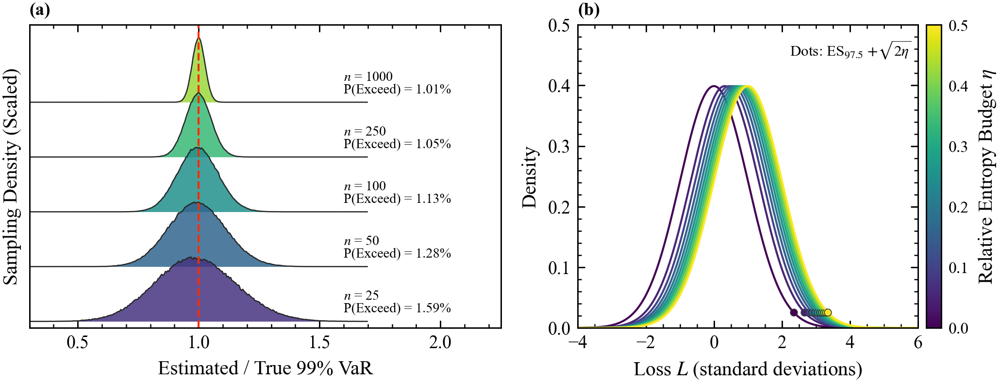
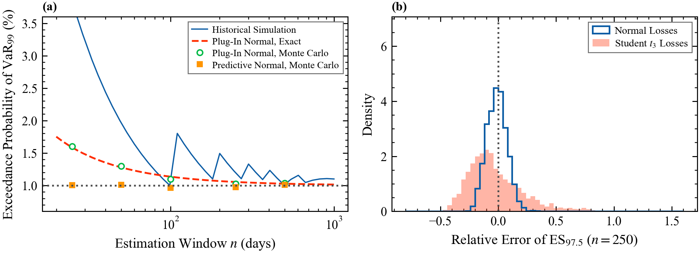

# 3. Model risk and estimation risk

Deck: [`slides/decks/03-model-risk-estimation-risk.pdf`](../../slides/decks/03-model-risk-estimation-risk.pdf) · Code: [`model_risk.py`](../../src/stochastic_risk/model_risk.py) · Experiments: `e06_estimation_risk.py`, `e07_model_uncertainty.py`

*Sampling distributions of the plug-in normal 99% VaR for five window lengths, with the exact exceedance probability of each; and the worst-case exponential tilts of a standard normal loss.*

## The question

Every risk number comes from a model, and every model is fitted to limited data. How much of a risk estimate is the risk, and how much is the model and the sample? Two parts: **estimation risk** (the right model with estimated parameters) and **model uncertainty** (which model is right at all).

## SR 26-2

On 17 April 2026 the Federal Reserve, OCC and FDIC issued revised guidance on model risk management, superseding SR 11-7 (2011) and SR 21-8.

- Risk-based and tailored; most relevant to banking organizations with over \$30 billion in total assets.
- A narrower model definition: a complex quantitative method that uses statistical, economic or financial theory to turn input data into estimates. Simple arithmetic and deterministic rules are out.
- Generative and agentic AI are outside its scope; other AI models are in.
- Materiality comes from model exposure and purpose.
- Validation covers conceptual soundness, outcomes analysis (including back-testing) and ongoing monitoring, with effective challenge by objective experts.

This topic makes two of these concrete: outcomes analysis has sampling error, and conceptual soundness needs alternatives to compare against.

## Estimation risk: exact results

**Plug-in normal VaR.** From $n$ i.i.d. normal losses with sample mean $\bar L$ and sample standard deviation $s$, the next loss satisfies $(L_{n+1} - \bar L)/(s\sqrt{1+1/n}) \sim t_{n-1}$. So the plug-in VaR $\bar L + s z_\alpha$, with $z_\alpha$ the normal quantile, is exceeded with probability

$$P = 1 - T_{n-1}\!\left(\frac{z_\alpha}{\sqrt{1+1/n}}\right) > 1 - \alpha,$$

where $T_{n-1}$ is the Student $t$ distribution function. The predictive VaR $\bar L + s\sqrt{1+1/n}\,t^{-1}_{n-1}(\alpha)$ has exact coverage.

**Historical simulation.** If the VaR is the $k$-th smallest of $n$ losses $L_{(k)}$, then for any continuous loss distribution $F$, $E[P(L_{n+1} > L_{(k)})] = (n+1-k)/(n+1)$, because $F(L_{(k)})$ is the $k$-th uniform order statistic.

Both are standard results. This repository checks them by simulation (`test_plugin_exceedance_formula_by_simulation`, `test_hs_order_statistic_exceedance_is_distribution_free`).

## Model uncertainty: relative-entropy worst case

Glasserman and Xu (2014). Among models $Q$ within relative entropy $D(Q\|P) = E_Q[\ln(\mathrm{d}Q/\mathrm{d}P)] \le \eta$ of the nominal model $P$, the largest $E_Q[V]$ is attained by the exponential tilt $\mathrm{d}Q/\mathrm{d}P = e^{\theta V}/E_P[e^{\theta V}]$, with $\theta \ge 0$ set so that the divergence equals $\eta$. It needs only scenarios simulated from the nominal model, reweighted.

Here $V = L$: take the model that maximizes expected loss, then compute its ES. For $L \sim N(0,1)$ the tilt is $N(\theta, 1)$ with $\theta = \sqrt{2\eta}$, so ES rises by exactly $\theta$. For heavy tails $E[e^{\theta L}] = \infty$ and the tilt does not exist.

## Results in this repository

- **Exceedance of estimated VaR (E06).** A plug-in normal 99% VaR is exceeded 1.59% of the time with $n = 25$ and 1.05% with $n = 250$ (Monte Carlo 1.03%). The predictive VaR gives 0.97%. HS with the third-largest of 250 losses: 1.20%. HS with the $\lceil 0.99n\rceil$-th order statistic has a sawtooth in $n$: 1.49% at $n = 200$.
- **Sampling error of ES (E06).** The empirical 97.5% ES from 250 days has a relative standard error of 9% for normal losses and 30% for $t_3$ losses (bias −2%). Percentile bootstrap 95% intervals cover the truth 82% and 75% of the time.
- **Worst case, light tails (E07).** Normal losses, 2 million reweighted scenarios: at $\eta = 0.1$ the worst-case ES is 1.19 times nominal, and the largest gap to the exact ES $+\sqrt{2\eta}$ is 0.004.
- **Worst case, heavy tails (E07).** Student $t_4$ losses, $\eta = 0.05$: the sample "worst case" is 1.5 to 3.7 times nominal with $10^4$ scenarios and 2.7 to 4.5 with $4\times10^6$. It depends on the largest draws, not on the model.
- **Challengers (E07).** The five estimators of topic 1 applied to the same 500-day GARCH-t window, 1,000 windows: the largest over the smallest 97.5% ES has median 1.37 and 90th percentile 1.98, and exceeds 1.5 in 34% of windows.

## Takeaways

1. Quote risk numbers with an estimation error, not as points.
2. Use predictive, not plug-in, quantiles when the sample is short.
3. Keep at least one challenger per material model and track the spread.
4. Express judgmental overlays as a divergence budget, where the tails allow it.

## Open questions

How to set $\eta$ from data and governance rather than by hand; worst-case bounds that stay finite for heavy-tailed losses.
