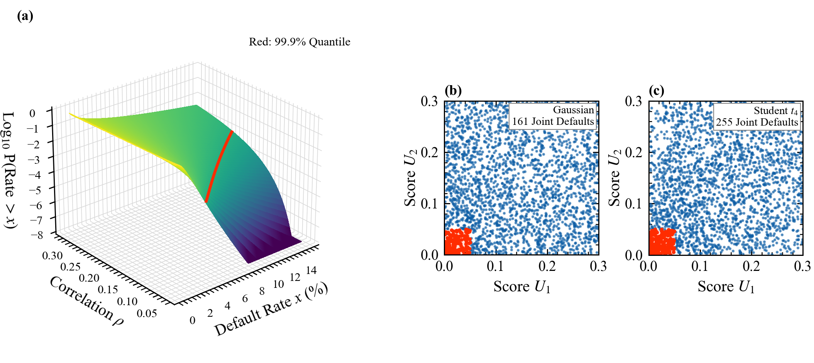
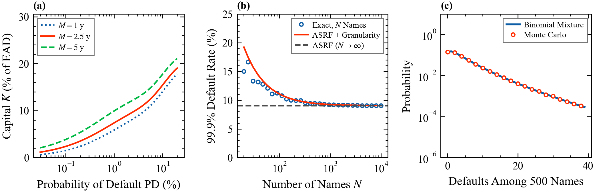

# 4. Credit portfolio risk

Deck: [`slides/decks/04-credit-portfolio-risk.pdf`](../../slides/decks/04-credit-portfolio-risk.pdf) · Code: [`credit.py`](../../src/stochastic_risk/credit.py) · Experiments: `e08_asrf.py`, `e09_copula_is.py`

*The probability that the default rate exceeds $x$, against asset correlation, with the 99.9% quantile in red; and 20,000 pairs of obligors under Gaussian and Student $t_4$ copulas with the same correlation, where the $t$ copula produces more joint defaults.* Animated: [`a2_credit_defaults.gif`](../../figures/animations/a2_credit_defaults.gif).

## The question

A loan book loses money when many borrowers default together. How large is the one-in-a-thousand-year loss, and how much does the answer depend on the dependence model and on how we simulate it? Basel IRB capital is a closed-form 99.9% quantile from a one-factor model. Economic capital models simulate richer portfolios, where 99.9% events are rare and plain Monte Carlo is slow.

## The one-factor model

Obligor $i$ defaults within a year when $\sqrt\rho\,Y + \sqrt{1-\rho}\,\varepsilon_i > \Phi^{-1}(1-p_i)$. The systematic factor $Y$ and the idiosyncratic terms $\varepsilon_i$ are independent standard normals (large $Y$ is a bad year), $p_i$ is the one-year default probability and $\rho$ the asset correlation (dimensionless). Given $Y = y$, defaults are independent with

$$p_i(y) = \Phi\!\left(\frac{\Phi^{-1}(p_i) + \sqrt\rho\,y}{\sqrt{1-\rho}}\right).$$

For an infinitely granular portfolio with equal PD $p$, the default rate is $p(Y)$, so its $q$-quantile is $p(\Phi^{-1}(q))$. Capital contributions that do not depend on the rest of the portfolio require one systematic factor and no large single exposures (Gordy, 2003).

## The Basel IRB formula

For corporate exposures, with PD and loss given default LGD as decimals and effective maturity $M$ (years) (BCBS, 2005):

$$R = 0.12\,w + 0.24\,(1-w), \quad w = \frac{1-e^{-50\,PD}}{1-e^{-50}}, \quad b = (0.11852 - 0.05478\ln PD)^2,$$

$$K = \left[LGD\;\Phi\!\left(\frac{\Phi^{-1}(PD)}{\sqrt{1-R}} + \sqrt{\frac{R}{1-R}}\,\Phi^{-1}(0.999)\right) - PD\cdot LGD\right]\frac{1 + (M-2.5)\,b}{1 - 1.5\,b}.$$

$K$ is capital per unit of exposure at default (EAD), and risk-weighted assets are $12.5\,K\cdot EAD$. The bracket is the 99.9% conditional loss minus the expected loss. PD 1%, LGD 45%, $M = 2.5$ gives $K = 7.39\%$, a risk weight of 92.3%. The formula assumes one factor, infinite granularity, Gaussian dependence and fixed LGD.

## Granularity: a second-order correction (derived here)

Write $X = E[L \mid Y] = m(Y)$ and $v(Y) = \mathrm{Var}(L \mid Y)$. Expanding the quantile of $L = X + (L - X)$ to second order and changing variables from $X$ to $Y$ gives

$$\mathrm{VaR}_q(L) \approx m(y_q) + \Delta, \qquad \Delta = -\frac{1}{2h(y)}\frac{\mathrm{d}}{\mathrm{d}y}\left[\frac{h(y)\,v(y)}{m'(y)}\right]_{y=y_q}, \qquad y_q = \Phi^{-1}(q),$$

with $h$ the standard normal density. For $N$ equal names with unit LGD, $m = p(y)$ and $v = p(y)(1-p(y))/N$, so $\Delta$ is of order $1/N$. Because large $Y$ is a bad year, $m$ increases in $y$ and $m'(y) > 0$. The expansion treats the idiosyncratic noise $L - X$ as small and assumes $m$, $v$ and $h$ are smooth; the backup slides of the overview deck give the steps. For small $N$ the default rate moves in steps of $1/N$, and no smooth correction can match it exactly.

## Importance sampling (Glasserman and Li, 2005)

Exposures $c_i$ (loss given default, currency), loss $L = \sum_i c_i\mathbf{1}\{\text{default}_i\}$, target $P(L > x)$.

1. **Twist given the factor.** Replace $p_i(y)$ by $q_i = p_i(y)e^{\theta c_i}/(1 + p_i(y)(e^{\theta c_i}-1))$, with $\theta = \theta_x(y) \ge 0$ solving $\partial_\theta\psi(\theta, y) = x$, where $\psi(\theta, y) = \sum_i\ln(1 + p_i(y)(e^{\theta c_i}-1))$ is the conditional cumulant generating function.
2. **Shift the factor.** Draw $Y \sim N(\mu, 1)$ with $\mu$ maximizing $\psi(\theta_x(y), y) - \theta_x(y)x - y^2/2$.

The estimator $\mathbf{1}\{L > x\}\,e^{-\theta L + \psi(\theta, Y)}\,e^{-\mu Y + \mu^2/2}$ is unbiased.

## Results in this repository

- **IRB capital (E08)** matches a reference value to $10^{-5}$.
- **Finite portfolios (E08).** PD 1%, $\rho = 0.12$: the infinitely granular 99.9% default rate is 9.03%. With $N = 89$ names the exact value is 11.2% and the granularity-adjusted value 11.3%; with $N = 946$, 9.20% and 9.25%. Simulated default counts (500 names, $10^6$ years) match the exact binomial mixture to 0.0006.
- **Copulas (E09).** 1,000 obligors in five grades, $\rho = 0.15$, LGD 45%, 2,000,000 simulated years per copula. Same PDs and correlation; a Student $t$ copula divides all latent variables by a common $\sqrt{W/\nu}$ (with $W$ a $\chi^2_\nu$ variable), which makes joint defaults more likely. 99.9% loss: Gaussian 6.53%, $t_{10}$ 11.75%, $t_4$ 17.56% of exposure (2.69 times Gaussian).
- **Importance sampling (E09).** At $P(L > x) = 10^{-4}$ with 20,000 scenarios: relative error 1.3% against 71% for plain Monte Carlo, a variance reduction factor of 2,756 per scenario.

## Takeaways

- Validate economic capital against the exact one-factor case first.
- Report the copula and correlation sensitivity of capital.
- Use importance sampling for tail quantiles and risk contributions.

## Open questions

Multi-factor capital allocation with stable contributions; stochastic and correlated LGD; calibrating tail dependence from short default histories.
