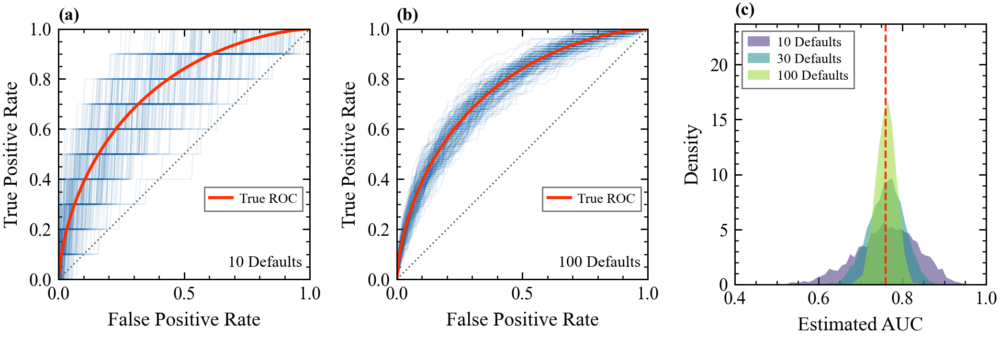
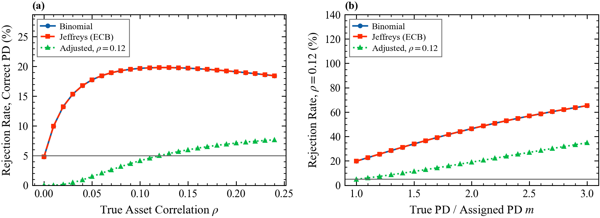

# 5. Validating probability-of-default models

Deck: [`slides/decks/05-pd-model-validation.pdf`](../../slides/decks/05-pd-model-validation.pdf) · Code: [`pd_validation.py`](../../src/stochastic_risk/pd_validation.py) · Experiments: `e10_calibration_tests.py`, `e11_discrimination.py`

*150 simulated ROC curves around the true curve with 10 and 100 defaults, and the sampling density of the AUC.*

## The question

A rating model assigns each borrower a probability of default (PD). Every year the validation function checks it against realized defaults. Do the standard tests mean what their p-values say?

- **Discrimination:** does the model rank defaulters above non-defaulters?
- **Calibration:** are the PDs right on average, by grade?
- **Stability:** is today's population like the development sample?

Defaults in one year share the economy, so they are not independent. Most textbook tests assume they are.

## Discrimination

Scores $S$, higher meaning riskier, for $n_D$ defaulters and $n_N$ non-defaulters:

$$\mathrm{AUC} = P(S_D > S_N) + \tfrac12 P(S_D = S_N), \qquad \mathrm{Gini} = 2\,\mathrm{AUC} - 1,$$

estimated by the Mann-Whitney statistic. **DeLong standard error** (DeLong et al., 1988): with $\psi(x, y) = \mathbf{1}\{x > y\} + \tfrac12\mathbf{1}\{x = y\}$, define $V_{10,i} = \frac{1}{n_N}\sum_j\psi(S_{D,i}, S_{N,j})$ for each defaulter and $V_{01,j} = \frac{1}{n_D}\sum_i\psi(S_{D,i}, S_{N,j})$ for each non-defaulter. Then $\widehat{\mathrm{Var}}(\mathrm{AUC}) = s_{10}^2/n_D + s_{01}^2/n_N$, with $s^2$ the sample variances. The ECB's validation reporting compares the current AUC with the AUC at initial validation through a normal approximation (ECB, 2019).

## Calibration

A grade with $N$ obligors, $D$ defaults in the year and assigned PD $p$.

- **Binomial test.** p-value $P(\mathrm{Bin}(N, p) \ge D)$.
- **Jeffreys test** (ECB, 2019). With the Jeffreys prior, the default rate has posterior $\mathrm{Beta}(D + \tfrac12, N - D + \tfrac12)$, and the p-value is its distribution function at $p$. Small values say $p$ is too low. The ECB applies it per grade and to the portfolio, under a binomial model with independent observations.
- **Hosmer-Lemeshow** over $G$ grades: $\sum_g (D_g - N_g p_g)^2/(N_g p_g(1-p_g)) \sim \chi^2_G$ for PDs fixed in advance.
- **Correlation-adjusted test.** If defaults follow the one-factor model with asset correlation $\rho$ (topic 4), then $P(D' \ge D) = \int P(\mathrm{Bin}(N, p(y)) \ge D)\,h(y)\,\mathrm{d}y$, with $p(y)$ the conditional PD and $h$ the standard normal density. `vasicek_pvalue` computes it exactly by quadrature.

## Stability

Population stability index over bins $k$ with expected shares $e_k$ and actual shares $a_k$: $\mathrm{PSI} = \sum_k (a_k - e_k)\ln(a_k/e_k)$. A common alarm level is 0.10.

## Results in this repository

- **Correct PDs, correlated defaults (E10).** $N = 1{,}000$, PD 1%, exact probabilities. With $\rho = 0$ the binomial test rejects 4.8% (it is discrete). At $\rho = 0.12$ the binomial and Jeffreys tests both reject 20% of the time, and the correlation-adjusted test 5.0%. The binomial test rejects at $D \ge 16$, the adjusted one at $D \ge 32$.
- **The price of honest size (E10).** When the true PD is twice the assigned one and $\rho = 0.12$, the binomial test rejects 46% and the adjusted test 19%. One year of defaults cannot reliably tell 1% from 2% once correlation is admitted.
- **AUC intervals (E11).** Binormal scores with true AUC 0.760 and 50 non-defaulters per default: the 95% DeLong interval covers 89.6% of the time with 10 defaults (AUC standard deviation 0.075) and 94.3% with 100.
- **PSI false alarms (E11).** With no population shift at all, PSI over 10 bins exceeds 0.10 in 39% of samples of 100 (3% at 200). The approximation $\mathrm{PSI} \approx (1/n + 1/n_{dev})\chi^2_9$, with $n$ and $n_{dev}$ the current and development sample sizes, tracks it.

## Takeaways

1. Read a binomial or Jeffreys rejection as "look closer", not as proof, in a correlated portfolio.
2. Report the correlation-adjusted p-value alongside.
3. Scale PSI thresholds with sample size, or use its $\chi^2$ distribution.

**Assumptions.** One-factor default dependence; one grade; one year. Multi-year tests and rating migration are the natural extensions.
