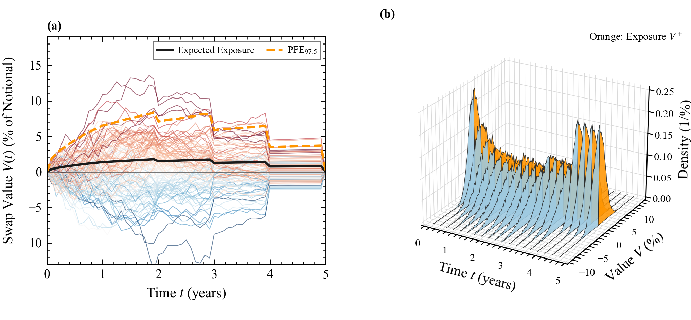
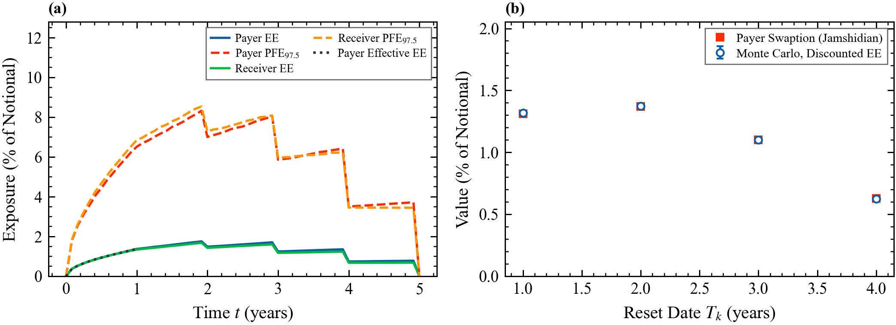

# 6. Counterparty credit risk and CVA

Deck: [`slides/decks/06-counterparty-risk-cva.pdf`](../../slides/decks/06-counterparty-risk-cva.pdf) · Code: [`ccr.py`](../../src/stochastic_risk/ccr.py) · Experiments: `e12_exposure.py`, `e13_cva_wwr.py`

*Hull-White paths of the swap value with EE and the 97.5% PFE, and the value distribution every quarter with the exposure part in orange.* Animated: [`a3_exposure_paths.gif`](../../figures/animations/a3_exposure_paths.gif).

## The question

A derivative is an asset when it is in the money, and the counterparty may default before paying. How much could we lose, when, and what is that worth today? Exposure is a random path, not a number, so it needs simulation of the market over the life of the trade. When default and exposure move together (wrong-way risk), independence assumptions understate both.

## Exposure metrics

With $V(t)$ the netting set's value to us (currency), exposure is $V(t)^+ = \max(V(t), 0)$.

| Metric | Definition |
|---|---|
| Expected exposure | $EE(t) = E[V(t)^+]$ |
| Potential future exposure | $PFE_q(t)$, the $q$-quantile of $V(t)^+$ (here $q = 97.5\%$) |
| Expected positive exposure (EPE) | time average of $EE$ over the first year |
| Effective EE | $\max_{s \le t} EE(s)$ |
| Effective EPE (EEPE) | first-year average of effective EE |

Under the internal model method, exposure at default is $\alpha\cdot EEPE$ with $\alpha = 1.4$. SA-CCR uses $EAD = 1.4\,(RC + PFE)$ with the same $\alpha$, where $RC$ is the replacement cost.

## Hull-White simulation

Short rate $r(t) = x(t) + \phi(t)$ with $\mathrm{d}x = -a\,x\,\mathrm{d}t + \sigma\,\mathrm{d}W$, mean reversion $a$ (1/year), volatility $\sigma$ (1/year$^{3/2}$), and $\phi$ fitted to a flat curve $P^M(0,t) = e^{-r_0 t}$. Zero-coupon bonds (Brigo and Mercurio, 2006):

$$P(t,T) = \frac{P^M(0,T)}{P^M(0,t)}\exp\Big\{\tfrac12\big[\Gamma(t,T) - \Gamma(0,T) + \Gamma(0,t)\big] - B(t,T)\,x(t)\Big\},$$

$$B = \frac{1-e^{-a\tau}}{a}, \qquad \Gamma = \frac{\sigma^2}{a^2}\Big[\tau + \tfrac{2}{a}e^{-a\tau} - \tfrac{1}{2a}e^{-2a\tau} - \tfrac{3}{2a}\Big], \qquad \tau = T - t,$$

with $\Gamma(t,T)$ the variance of $\int_t^T x(u)\,\mathrm{d}u$ given $x(t)$ (dimensionless). The pair $x(t)$ and $\int_0^t x$ is jointly Gaussian and is simulated exactly, so the bank-account discount factor $D(0,t)$ satisfies $E[D(0,t)] = P^M(0,t)$. In code, `HullWhite.V` is $\Gamma$.

A payer swap (pay fixed $K$, unit notional, annual dates $T_k$, accrual $\delta = 1$ year, $L_k$ the rate fixed at $T_{k-1}$) inside $(T_{k-1}, T_k]$ is worth

$$V(t) = P(t,T_k)(1 + \delta L_k) - P(t,T_n) - K\delta\sum_{i \ge k}P(t,T_i).$$

**Exact check.** At a reset date the discounted expected exposure of the swap is a payer swaption price, which Jamshidian's decomposition gives in closed form as a sum of zero-coupon bond puts.

## CVA and wrong-way risk

Independent default, with loss given default $LGD$ and survival $S(t) = e^{-\lambda t}$ at hazard $\lambda$ (1/year):

$$\mathrm{CVA} = LGD\sum_i E\big[D(0,t_i)\,V(t_i)^+\big]\,\big(S(t_{i-1}) - S(t_i)\big).$$

**Wrong-way risk** (Hull and White, 2012): the hazard depends on the exposure on each path, $\lambda_i = \exp(a_i + b\,V(t_i)/1\%)$. The $a_i$ are calibrated so that expected survival matches the credit curve, and $b$ (per 1% of notional) sets the dependence. With $b > 0$ the counterparty is more likely to default when it owes us more. CVA becomes $LGD\sum_i E[D(0,t_i)V(t_i)^+(S_{i-1} - S_i)]$ with path-wise survival $S_i$. With $b = 0$ it reduces to the independent CVA.

## Results in this repository

- **Exposure profiles (E12).** Five-year swap at par ($K = 3.045\%$), $a = 0.05$, $\sigma = 1\%$, flat 3% curve, 50,000 paths. Payer EE peaks at 1.75% of notional near year 1.9; $PFE_{97.5}$ peaks at 8.31%. EPE 0.879%, EEPE 0.879%, $EAD = 1.4\times EEPE = 1.231\%$.
- **Exact check (E12).** Simulated discounted EE at reset dates agrees with the Jamshidian swaption price within 0.7 standard errors. The bond martingale test holds to $2\times10^{-4}$.
- **Wrong-way risk (E13).** Hazard 2% a year, LGD 60%, 40,000 paths. Independent CVA is 6.1 bp of notional for the payer and 6.0 bp for the receiver. At $b = 0.3$ the payer CVA is 2.40 times its independent value; at $b = -0.3$ (right-way), 0.26 times. Wrong-way risk moves CVA toward the dates where exposure is high on the paths that default.

## Takeaways

1. Benchmark simulated exposures against analytic prices before trusting tails.
2. Report CVA sensitivity to a wrong-way parameter, not one number.
3. Model margin periods of risk explicitly for collateralized sets.

**Assumptions.** One-factor rates, one uncollateralized swap, no netting or margin, hazard driven by exposure only.

## Open questions

Calibrating wrong-way dependence from data that rarely contain defaults; joint simulation of market and credit at portfolio scale.
