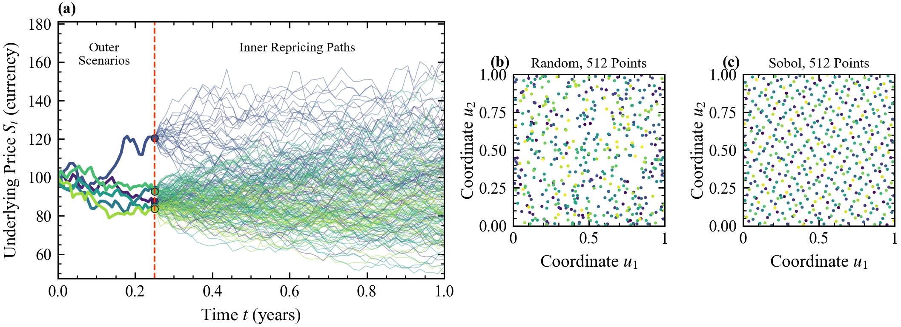
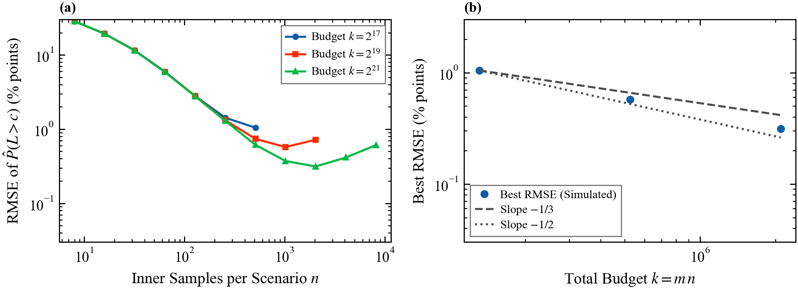

# 7. Monte Carlo methods for risk

Deck: [`slides/decks/07-monte-carlo-methods.pdf`](../../slides/decks/07-monte-carlo-methods.pdf) · Code: [`montecarlo.py`](../../src/stochastic_risk/montecarlo.py) · Experiments: `e14_nested.py`, `e15_variance_reduction.py`

*A nested simulation tree (outer scenarios to a three-month horizon, then inner repricing paths), and 512 random against 512 scrambled Sobol points.*

## The question

Most risk numbers are Monte Carlo estimates, and Monte Carlo has its own error. How should a fixed computing budget be spent, and how small can the error be made? Tail probabilities are rare events, so plain sampling wastes most scenarios. Portfolios of derivatives need a valuation inside every scenario. Smooth expectations converge faster with well-spread points than with random ones.

## Monte Carlo error

Estimating $\mu = E[f(X)]$ by the mean of $n$ independent draws has standard error $s/\sqrt n$, with $s$ the standard deviation of $f(X)$ (Glasserman, 2003). For a tail probability $\alpha = P(L > c)$ the indicator has variance $\alpha(1-\alpha)$, so the relative error is $\sqrt{(1-\alpha)/(\alpha n)} \approx 1/\sqrt{\alpha n}$. A 10% relative error at $\alpha = 10^{-4}$ needs $10^6$ scenarios. The error of an estimated VaR scales like $\sqrt{\alpha(1-\alpha)/n}$ divided by the loss density at the quantile, which is small in the tail.

## Nested simulation

Risk at horizon $\tau$ (years) of a derivatives portfolio needs its value $V_\tau$ in each outer scenario, and that value is itself an expectation. With $m$ outer scenarios and $n$ inner draws each, $\hat V_\tau = V_\tau + $ noise with variance $s^2/n$. Gordy and Juneja (2010): for $\alpha = P(L > c)$ the inner noise biases the estimate by about $\theta/n$, with $\theta$ a constant set by the loss density and the inner variance at $c$, and the outer sampling adds variance $\alpha(1-\alpha)/m$. With budget $k = mn$,

$$\mathrm{MSE} \approx \frac{\theta^2}{n^2} + \frac{\alpha(1-\alpha)\,n}{k},$$

minimized at $n \propto k^{1/3}$, so the best RMSE falls like $k^{-1/3}$, not $k^{-1/2}$.

**Test portfolio.** A long one-year at-the-money call (Black-Scholes, volatility 25%, rate 2%), one-week horizon. The loss level $c = 4.13$ is the exact 1% quantile. The exact inner value is known, so the bias is measurable.

## Importance sampling and quasi-Monte Carlo

**Importance sampling.** Sample from a density $g$ that makes the event common and reweight by $f/g$. For $P(X > c)$ with $X \sim N(0,1)$, sample $X_i \sim N(c, 1)$ and use $\hat\alpha = \frac1n\sum_i\mathbf{1}\{X_i > c\}\,e^{-cX_i + c^2/2}$. The relative error stays bounded as $c$ grows. Portfolio credit risk uses the same idea with a factor shift and a twist (topic 4).

**Quasi-Monte Carlo.** Replace random points by low-discrepancy points (Sobol). Scrambled points keep the estimator unbiased and give an error estimate from independent replications. For smooth integrands the error can fall close to $n^{-1}$, against $n^{-1/2}$. Test: an arithmetic basket call on five correlated assets.

## Results in this repository

- **Inner-sample bias (E14).** RMSE of $\hat P(L > c)$ (true 1%) against the inner sample size, 100 replications per point. With $n = 8$ the estimate is off by 28.38 percentage points: inner noise swamps the one-week loss.
- **Optimal split (E14).** The best $n$ rises from 512 to 2048 as the budget grows 16-fold ($2^{17}$ to $2^{21}$). The best RMSE falls with fitted slope −0.43 over three budgets. The asymptotic rate is $-1/3$; with $n$ restricted to powers of two and 100 replications, the optimum is located only roughly, so this slope is a coarse check.
- **Importance sampling (E15).** $10^5$ samples, 50 replications. At $c = 4$ ($\alpha \approx 3\times10^{-5}$) plain Monte Carlo has relative error 66% and importance sampling 0.5%. At $c = 6$ importance sampling still gives 0.9%, where plain Monte Carlo sees no hits at all.
- **Quasi-Monte Carlo (E15).** Basket price 7.5981. Fitted error slopes: Monte Carlo −0.51, scrambled Sobol −0.76. At $2^{16}$ points Sobol is 37 times more accurate.

## Takeaways

1. Report the Monte Carlo error with every risk number.
2. For nested problems, tune the inner sample size, or replace inner simulation by a regression proxy and validate it.
3. Use importance sampling for 99.9% credit and operational capital.

## Open question

Error bounds for machine-learned pricing proxies inside risk engines.
