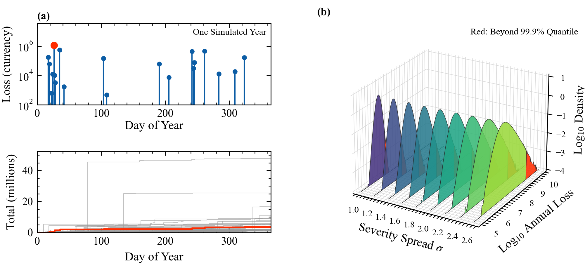
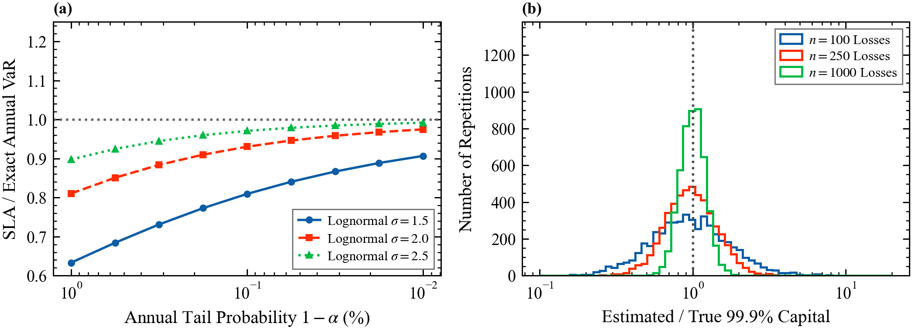

# 8. Operational risk and extreme values

Deck: [`slides/decks/08-operational-risk-evt.pdf`](../../slides/decks/08-operational-risk-evt.pdf) · Code: [`oprisk.py`](../../src/stochastic_risk/oprisk.py), [`evt.py`](../../src/stochastic_risk/evt.py) · Experiments: `e16_lda.py`, `e17_evt.py`

*One simulated year of losses, and annual-loss distributions for severity spreads from 1.0 to 2.6 on log scales (red: beyond the 99.9% quantile).* Animated: [`a4_operational_losses.gif`](../../figures/animations/a4_operational_losses.gif).

## The question

Fraud, outages, legal settlements: a few huge losses dominate the total. How do we estimate a one-in-a-thousand-year annual loss from a few hundred recorded events, and how sure can we be? Heavy tails make the largest loss the main driver of the annual total. Extreme value theory tells us how to extrapolate beyond the data, and how uncertain that is.

## The loss distribution approach

Annual loss $S = X_1 + \dots + X_N$, with frequency $N \sim \mathrm{Poisson}(\lambda)$ ($\lambda$ in events per year) and i.i.d. severities $X_k$ (currency) with distribution function $F$, independent of $N$.

**Exact distribution.** Discretize $F$ on a grid of span $h$ (currency) into probabilities $f_X$, and compute the compound Poisson law by the fast Fourier transform, $f_S = \mathrm{IFFT}\big(\exp(\lambda(\mathrm{FFT}(f_X) - 1))\big)$, with zero padding against wrap-around. Panjer's recursion, $f_S(k) = \frac{\lambda}{k}\sum_{j=1}^{k} j\,f_X(j)\,f_S(k-j)$, gives the same numbers (tested to $10^{-10}$).

**Single-loss approximation (SLA)** (Böcker and Klüppelberg, 2005). For subexponential (heavy-tailed) severities,

$$\mathrm{VaR}_\alpha(S) \approx F^{-1}\!\left(1 - \frac{1-\alpha}{\lambda}\right) \qquad (\alpha \to 1).$$

At very high levels the annual total is large because one loss is. The capital is then a severity quantile, so its accuracy hinges on the severity tail.

## Extreme value theory

**Peaks over threshold (POT).** Excesses $Y = L - u$ over a high threshold $u$ are approximately generalized Pareto, $P(Y \le y) = 1 - (1 + \xi y/\beta)^{-1/\xi}$, with shape $\xi$ (the tail index; $\xi > 0$ for heavy tails) and scale $\beta$ (loss units). With $N_u$ of $n$ losses above $u$,

$$\mathrm{VaR}_\alpha = u + \frac{\beta}{\xi}\left[\left(\frac{n(1-\alpha)}{N_u}\right)^{-\xi} - 1\right]$$

(McNeil, Frey and Embrechts, 2015).

**Hill estimator** from the $k$ largest losses, for Pareto-type tails: $\hat\xi = \frac1k\sum_{i=1}^{k}\ln X_{(n-i+1)} - \ln X_{(n-k)}$, with $X_{(j)}$ the order statistics.

**The trade-off.** A high threshold (small $k$) keeps the model accurate but leaves few points; a low one adds points the model does not describe. There is no automatic answer.

## Results in this repository

- **SLA accuracy (E16).** $\lambda = 25$ a year, lognormal severities with log-mean $\mu = 10$. At 99.9% the SLA over the exact FFT value is 0.81 (log-standard deviation $\sigma = 1.5$), 0.93 ($\sigma = 2$) and 0.97 ($\sigma = 2.5$); at 99% with $\sigma = 2$ it is 0.81. It errs low and improves with the level and with tail heaviness.
- **Capital estimation risk (E16).** True $\sigma = 2$. The bank fits a lognormal by maximum likelihood to $n$ observed losses and computes 99.9% capital by the SLA, which is 58.7 million at the true parameters. Over 5,000 repetitions, the 90% range of the estimate over that value is 0.37 to 2.52 with $n = 100$ and 0.74 to 1.36 with $n = 1{,}000$, with the model correctly specified.
- **Quantile estimation (E17).** Student $t_3$ losses ($\xi = 1/3$), 1,000 samples per size. RMSE of $\ln(\widehat{\mathrm{VaR}}/\mathrm{VaR})$ for the 99.9% quantile at $n = 1{,}000$: empirical 0.31, normal fit 0.68, POT at the 90% threshold 0.25. At $n = 250$: empirical 0.55, POT 0.53.
- **Hill plot (E17).** In one sample of 2,500, the Hill estimate moves from 0.39 (30 points) to 0.60 (1,000 points), against the true 0.33. Using too much of the sample biases $\hat\xi$, because the body of a $t$ distribution is not Pareto.

## Takeaways

1. Report capital with an interval, from bootstrap or from the estimator's sampling distribution.
2. Show threshold sensitivity (Hill or GPD-shape plots) in every EVT fit.
3. Use the exact FFT distribution to check approximations.

## Open question

Combining internal losses, external data and scenarios into one tail estimate with honest uncertainty.
