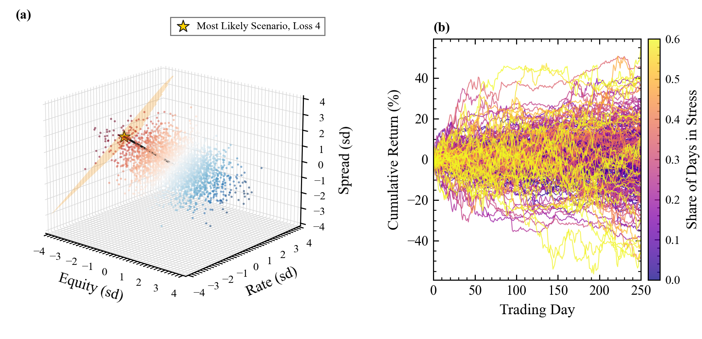
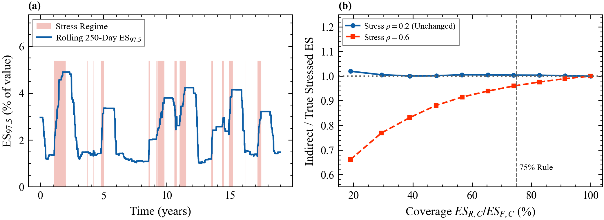

# 9. Stress testing and scenario generation

Deck: [`slides/decks/09-stress-testing.pdf`](../../slides/decks/09-stress-testing.pdf) · Code: [`stress.py`](../../src/stochastic_risk/stress.py) · Experiments: `e18_reverse_stress.py`, `e19_regimes.py`

*Scenarios coloured by portfolio loss with the loss plane and the most likely scenario, and regime-switching paths coloured by the share of days in stress.* Animated: [`a5_reverse_stress_3d.gif`](../../figures/animations/a5_reverse_stress_3d.gif).

## The question

Statistical risk measures look at the recent past. Stress tests ask what a bad state of the world would do. Which scenario should we fear, how plausible is it, and how do we calibrate risk to a stress period we no longer observe?

## Reverse stress testing a linear portfolio

Risk factor changes $x \sim N(0, \Sigma)$ with covariance $\Sigma$, portfolio P&L $w^\top x$ with weights $w$, loss $\ell = -w^\top x$. Among all scenarios with loss $\ell$, the most likely one (largest density, smallest Mahalanobis distance $\sqrt{x^\top\Sigma^{-1}x}$) solves

$$\min_x\; x^\top\Sigma^{-1}x \quad\text{s.t.}\quad -w^\top x = \ell \qquad\Longrightarrow\qquad x^* = -\ell\,\frac{\Sigma w}{w^\top\Sigma w}, \qquad d = \frac{\ell}{\sqrt{w^\top\Sigma w}},$$

and $P(\text{loss} \ge \ell) = 1 - \Phi(d)$. For Gaussian $x$, $x^*$ is also $E[x \mid -w^\top x = \ell]$. The scenario moves every factor in proportion to its covariance with the portfolio, so correlated factors share the blame. The same loss is more plausible when correlations rise, because $w^\top\Sigma w$ grows.

## Regimes and the FRTB stress calibration

**Regime switching.** A two-state Markov chain (calm, stress) with daily switching probabilities; given the state, returns are Gaussian with that state's volatilities and correlations. Rolling-window risk measures see the stress only after it has arrived, and remember it after it has gone.

**FRTB indirect calibration** (MAR33). The full-set ES in a stress period is approximated from a reduced set of risk factors with long history:

$$\mathrm{ES}_{F,S} \approx \mathrm{ES}_{R,S}\,\frac{\mathrm{ES}_{F,C}}{\mathrm{ES}_{R,C}},$$

with $F$ the full set, $R$ the reduced set, $C$ the current period and $S$ the stress period. The reduced set must explain at least 75% of the full current ES. The ratio is assumed the same in calm and stress. When correlations rise in stress, the factors left out contribute more in stress than in calm, so the ratio taken from calm data is too small.

## Generative scenario models

Historical and hypothetical scenarios are few. Generative models try to produce many realistic ones, including tails.

- **Tail-GAN** (Cont, Cucuringu, Xu and Zhang; arXiv 2203.01664) trains a generative adversarial network with a loss built on the joint elicitability of VaR and ES, so that generated multi-asset scenarios reproduce the tail risk of trading strategies.
- **Diffusion factor models** (Chen, Xu, Xu and Zhang; arXiv 2504.06566) build a latent factor structure into a diffusion model of high-dimensional returns. The authors report error bounds that depend on the number of factors rather than the number of assets.

A generator that matches marginal statistics can still misstate joint tails. Its scenarios need the same outcomes analysis as any risk model: backtests of the risk measures it implies (topic 2) and checks of the tail dependence it produces (topic 4).

## Results in this repository

- **Reverse stress scenario (E18).** Equity, rate and spread factors in standard deviations; the portfolio is long equity, gains when rates rise and loses when spreads widen. For a loss of 4 units the scenario is equity −1.89, rate −1.26, spread +1.69 standard deviations. Monte Carlo conditional means agree within 0.016.
- **Plausibility (E18).** The P&L standard deviation is 1.83 with calm correlations and 2.04 with stressed ones (correlations 1.6 times larger in magnitude). A loss of 6 has probability $5.2\times10^{-4}$ in calm conditions and $1.6\times10^{-3}$ in stress: 3.1 times more likely, from an 11% rise in P&L volatility.
- **Regimes (E19).** Ten factors; calm volatility 1% a day and correlation 0.2; stress volatility 2.5% and correlation 0.6; stress 18% of the time. Rolling 250-day ES lags each stress episode and decays slowly after it.
- **Indirect calibration (E19).** Indirect over true stressed ES, 500 repetitions. If correlations stay at 0.2, even one factor is enough (1.02). If they rise to 0.6, one factor (coverage 19%) gives 0.66, while the first reduced set that meets the 75% rule ($k = 8$ of 10 factors) gives 0.98.

## Takeaways

1. Report the Mahalanobis distance (plausibility) of every scenario, under both calm and stressed correlations.
2. Test the reduced factor set's ratio in historical stress windows, not only in the current window.
3. Validate generated scenarios by their implied risk measures and tail dependence.

## Open question

Reverse stress tests for nonlinear, multi-period portfolios with feedback.
